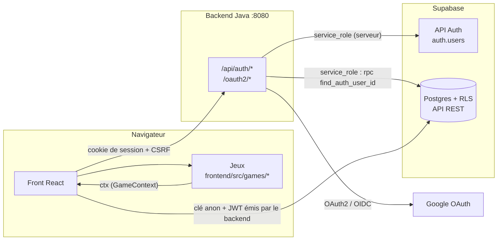
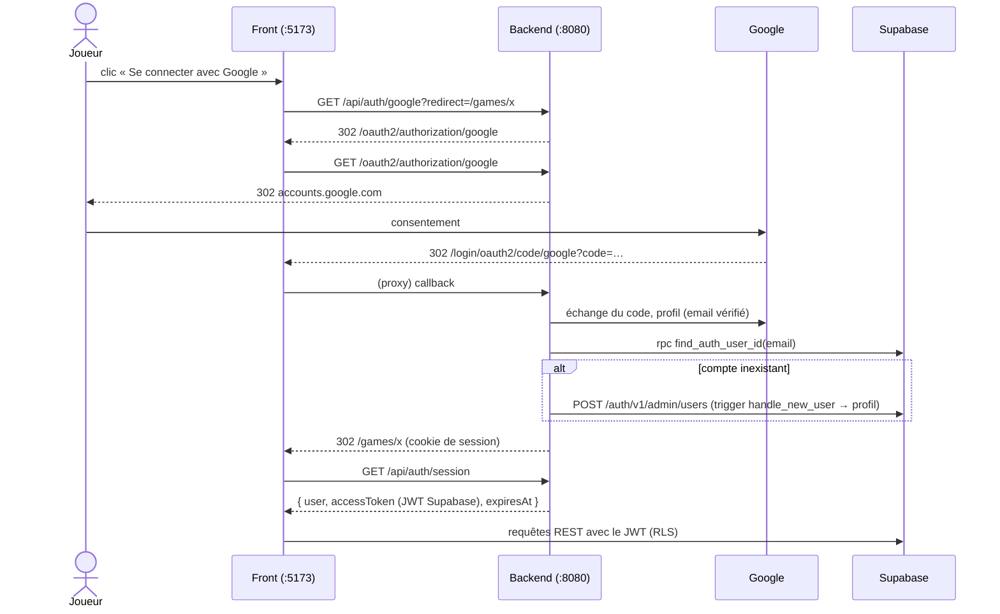

# Architecture

Tiki Gaming est un monorepo en trois briques :

| Brique      | Dossier      | Technologies                                         | Responsabilité                                   |
|-------------|--------------|------------------------------------------------------|--------------------------------------------------|
| Front       | `frontend/`  | Vite · React 19 · TypeScript · React Router          | Interface, catalogue, exécution des jeux          |
| Backend     | `backend/`   | Java 21 · Spring Boot 3.5 · Spring Security · Maven  | Authentification et session                       |
| Données     | `supabase/`  | Supabase (Postgres + RLS + API REST PostgREST)       | Comptes (`auth.users`), profils, scores, sauvegardes |

Le front lit et écrit **directement** dans Supabase via supabase-js. Le backend Java ne fait **que**
l'authentification : il ne sert aucune donnée de jeu.



## Authentification

Le backend gère la connexion Google, email/mot de passe, l'inscription et la réinitialisation du mot
de passe. Les comptes restent dans `auth.users` de Supabase, pour garder les clés étrangères et le
trigger de création de profil.

1. Le backend authentifie l'utilisateur (Google, ou API Auth de Supabase pour l'email/mot de passe).
2. Il garde l'utilisateur dans une **session HTTP** (cookie `JSESSIONID`, `HttpOnly`, `SameSite=Lax`).
3. `GET /api/auth/session` renvoie l'utilisateur et un **JWT au format Supabase**, valable 1 h et signé avec
   le secret JWT du projet (`sub` = id utilisateur, `role` = `authenticated`).
4. supabase-js envoie ce JWT à chaque requête (`frontend/src/lib/session.ts` le redemande avant son expiration).
   La RLS reconnaît l'utilisateur via `auth.uid()`. Sans session, supabase-js utilise la clé anon (mode invité).

### Connexion Google



Un compte Google est rattaché au compte Supabase **de même email** (seul un email vérifié par Google est
accepté), sinon un compte est créé.

### Endpoints

| Endpoint                          | Rôle                                                           |
|-----------------------------------|----------------------------------------------------------------|
| `GET  /api/auth/session`          | Utilisateur courant + JWT Supabase (1 h), émet le cookie CSRF   |
| `GET  /api/auth/google?redirect=` | Démarre la connexion Google (`redirect` : chemin relatif)       |
| `POST /api/auth/login`            | Email + mot de passe                                           |
| `POST /api/auth/signup`           | Inscription (pseudo transmis dans `data.username`)             |
| `POST /api/auth/password/forgot`  | Envoi du lien de réinitialisation                              |
| `POST /api/auth/password/reset`   | Nouveau mot de passe via le jeton du lien                      |
| `POST /api/auth/password`         | Changement de mot de passe (connecté)                          |
| `POST /api/auth/logout`           | Déconnexion                                                    |

Les `POST` exigent l'en-tête `X-XSRF-TOKEN` (copie du cookie `XSRF-TOKEN`), ajouté par
`frontend/src/lib/api.ts`. Les erreurs sont renvoyées sous la forme `{ "error": "message" }`.

### Même origine

Le front et le backend doivent être servis sur **la même origine** pour que le cookie de session soit
first-party. En dev, Vite proxifie `/api`, `/oauth2` et `/login/oauth2` vers `localhost:8080`
(`frontend/vite.config.ts`). En production, il faudra un reverse proxy ou des rewrites équivalents
(le mode de déploiement est à redéfinir).

## Front

```
frontend/src/
├── main.tsx                 Router + AuthProvider
├── App.tsx                  Déclaration des routes
├── styles.css               Tokens et composants (voir charte-graphique.md)
├── lib/
│   ├── api.ts               Appels au backend (cookie de session + CSRF)
│   ├── session.ts           Session backend + JWT, rafraîchi avant expiration
│   ├── supabase.ts          Client Supabase unique (clé anon + JWT du backend)
│   └── database.types.ts    Types de la base
├── auth/
│   ├── AuthContext.ts       useAuth() → user, profile, refreshSession, signOut…
│   ├── AuthProvider.tsx     Lit la session du backend, charge le profil
│   └── ProtectedRoute.tsx   ProtectedRoute / GuestOnlyRoute
├── components/              Layout, Leaderboard, GameTags…
├── pages/                   Home, Game, Login, Signup, ForgotPassword, UpdatePassword, Profile
└── games/
    ├── types.ts             Contrat GameDefinition / GameContext  ← à lire en premier
    ├── categories.ts        Catégories de jeux (solo, duel, multi)
    ├── sdk.ts               Implémentation du GameContext (scores, saves, classement)
    ├── registry.ts          Catalogue des jeux
    └── clicker/             Jeu d'exemple = template
```

### Routes

| Route              | Page                 | Accès                                                        |
|--------------------|----------------------|--------------------------------------------------------------|
| `/`                | `HomePage`           | tout le monde                                                |
| `/games/:slug`     | `GamePage`           | `mode: 'solo'` : invité autorisé ; `'multiplayer'` : connexion |
| `/login`, `/signup`, `/forgot-password` | pages d'auth | non connecté uniquement                          |
| `/update-password` | `UpdatePasswordPage` | connecté, ou via le lien de réinitialisation reçu par email  |
| `/profile`         | `ProfilePage`        | connecté                                                     |

### Modèle des jeux

Chaque jeu est un module autonome dans `frontend/src/games/<slug>/` qui exporte une `GameDefinition` :

| Champ         | Rôle                                                                     |
|---------------|--------------------------------------------------------------------------|
| `slug`        | Identifiant, = `games.slug` en base et URL `/games/<slug>`                |
| `title`, `description`, `thumbnail?` | Affichage dans le catalogue                       |
| `category`    | **Obligatoire.** Format de jeu : `solo`, `duel` ou `multi` (voir ci-dessous) |
| `mode`        | Accès : `solo` = jouable sans compte, `multiplayer` = connexion obligatoire |
| `component`   | Composant chargé à la demande (`lazy`)                                    |

Le jeu reçoit un `GameContext` (`ctx`) déjà limité au jeu et au joueur courants : scores,
classement, sauvegarde. Un jeu **n'importe jamais `@/lib/supabase`** directement.
Pour les jeux dont les règles doivent rester confidentielles, le composant React ne contient
que l'état d'affichage et appelle le backend Java. Le Mastermind utilise ainsi
`POST /api/games`, `POST /api/games/{id}/guesses` et `POST /api/games/{id}/restart` ;
le secret, les indices, les tentatives et le score sont calculés côté serveur.

#### Catégories

| Catégorie | Libellé | Joueurs        | Exemples du projet                    |
|-----------|---------|----------------|---------------------------------------|
| `solo`    | Solo    | 1 joueur       | Clicker, Rush Hour, Mastermind        |
| `duel`    | Duel    | 2 joueurs      | Échecs, Bataille navale, Orapa Mine   |
| `multi`   | Multi   | 3 joueurs et + | 7 Wonders, Yam                        |

La catégorie et le mode sont indépendants : un jeu `duel` contre une IA peut être en `mode: 'solo'`
(jouable sans compte). Les exemples ci-dessus sont indicatifs : chaque équipe choisit la catégorie de son jeu.

La liste est définie à deux endroits qui doivent rester alignés : `frontend/src/games/categories.ts`
et la contrainte `games_category_check` en base. Ajouter une catégorie = une migration qui remplace la
contrainte + une entrée dans `GAME_CATEGORIES` + un token `--cat-<nom>` dans la charte.

## Backend

```
backend/src/main/java/fr/tikigaming/
├── TikiGamingApplication.java
├── config/
│   ├── SecurityConfig.java            OAuth2 Google, CSRF par cookie, session
│   └── TikiProperties.java            Configuration tiki.* (application.yml)
└── auth/
    ├── AuthController.java            Endpoints /api/auth/*
    ├── AuthSession.java               Utilisateur en session, redirections sûres
    ├── GoogleLoginSuccessHandler.java Rattache le compte Google à auth.users
    ├── SupabaseAuthClient.java        API Auth / RPC Supabase (clé service_role)
    └── SupabaseTokenService.java      JWT au format Supabase pour la RLS
```

La configuration est lue depuis `backend/.env` (non versionné, modèle : `backend/.env.example`).

## Sécurité

- Le front n'utilise **que la clé `anon`** et le JWT émis par le backend. La clé `service_role` (qui
  contourne la RLS) et le secret JWT (qui permet de forger un jeton pour n'importe quel utilisateur)
  restent dans `backend/.env`. Ils ne doivent jamais apparaître dans le dépôt ni dans une variable `VITE_*`.
- Toutes les tables ont la RLS activée ; voir [modele-donnees.md](modele-donnees.md).
- Les redirections après connexion n'acceptent que des chemins relatifs (pas de redirection ouverte).
- En mode invité, aucune écriture n'est faite en base : seule la lecture publique (catalogue, classement) est utilisée.
- Les scores de jeux génériques sont envoyés par le client, donc falsifiables. Le Mastermind
  reçoit son score calculé par le backend Java après validation de la partie.
