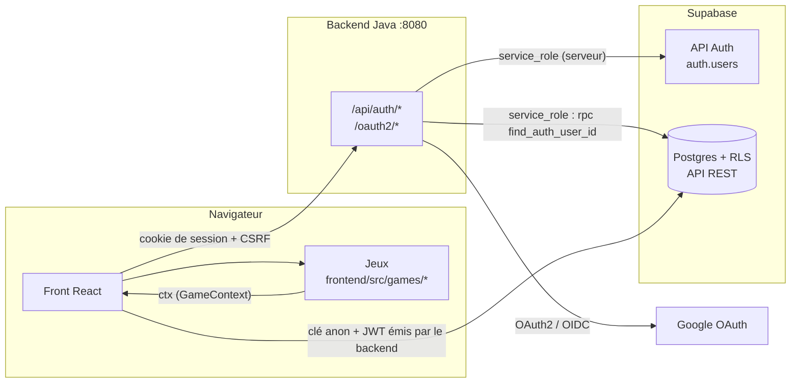
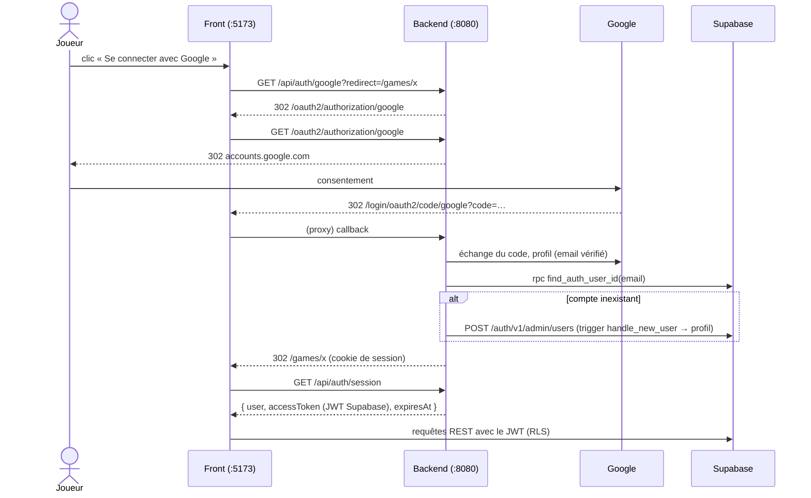

# Architecture

Tiki Gaming est un monorepo en trois briques :

| Brique      | Dossier      | Technologies                                         | Responsabilité                                   |
|-------------|--------------|------------------------------------------------------|--------------------------------------------------|
| Front       | `frontend/`  | Vite · React 19 · TypeScript · React Router          | Interface, catalogue, exécution des jeux          |
| Backend     | `backend/`   | Java 21 · Spring Boot 4.1 · Spring Security · Maven  | Authentification et session                       |
| Données     | `supabase/`  | Supabase (Postgres + RLS + API REST PostgREST)       | Comptes (`auth.users`), profils, scores, sauvegardes |

Le front lit et écrit **directement** dans Supabase via supabase-js. Le backend Java ne fait **que**
l'authentification : il ne sert aucune donnée de jeu.



## Authentification

Le backend gère la connexion Google, email/mot de passe, l'inscription et la réinitialisation du mot
de passe. Les comptes restent dans `auth.users` de Supabase, pour garder les clés étrangères et le
trigger de création de profil.

1. Le backend authentifie l'utilisateur (Google, ou API Auth de Supabase pour l'email/mot de passe).
2. Il garde l'utilisateur dans une **session HTTP** (cookie `JSESSIONID`, `HttpOnly`, `SameSite=Lax`).
3. `GET /api/auth/session` renvoie l'utilisateur et un **JWT au format Supabase**, valable 1 h et signé avec
   le secret JWT du projet (`sub` = id utilisateur, `role` = `authenticated`).
4. supabase-js envoie ce JWT à chaque requête (`frontend/src/lib/session.ts` le redemande avant son expiration).
   La RLS reconnaît l'utilisateur via `auth.uid()`. Sans session, supabase-js utilise la clé anon (mode invité).

### Connexion Google



Un compte Google est rattaché au compte Supabase **de même email** (seul un email vérifié par Google est
accepté), sinon un compte est créé.

### Endpoints

| Endpoint                          | Rôle                                                           |
|-----------------------------------|----------------------------------------------------------------|
| `GET  /api/auth/session`          | Utilisateur courant + JWT Supabase (1 h), émet le cookie CSRF   |
| `GET  /api/auth/google?redirect=` | Démarre la connexion Google (`redirect` : chemin relatif)       |
| `POST /api/auth/login`            | Email + mot de passe                                           |
| `POST /api/auth/signup`           | Inscription (pseudo transmis dans `data.username`)             |
| `POST /api/auth/password/forgot`  | Envoi du lien de réinitialisation                              |
| `POST /api/auth/password/reset`   | Nouveau mot de passe via le jeton du lien                      |
| `POST /api/auth/password`         | Changement de mot de passe (connecté)                          |
| `POST /api/auth/logout`           | Déconnexion                                                    |
| `POST /api/scores`                | Enregistre le score du joueur connecté (seul chemin d'écriture) |

Les `POST` exigent l'en-tête `X-XSRF-TOKEN` (copie du cookie `XSRF-TOKEN`), ajouté par
`frontend/src/lib/api.ts`. Les erreurs sont renvoyées sous la forme `{ "error": "message" }`.

### Swagger (OpenAPI)

La documentation interactive de l'API est générée depuis le code (springdoc-openapi) :

| URL (backend lancé)                     | Contenu                                    |
|-----------------------------------------|--------------------------------------------|
| http://localhost:8080/swagger-ui.html   | Swagger UI : endpoints, schémas, « Try it out » |
| http://localhost:8080/v3/api-docs       | Spécification OpenAPI 3.1 (JSON)           |

- Seuls les chemins `/api/**` sont documentés, regroupés par tag (`Authentification`, puis un tag par jeu).
- « Try it out » gère le CSRF comme le front : appeler `GET /api/auth/session` une fois, et Swagger
  recopie ensuite le cookie `XSRF-TOKEN` dans l'en-tête `X-XSRF-TOKEN`. La session (cookie `JSESSIONID`)
  est partagée avec le front, car les cookies ne dépendent pas du port.
- Activé par défaut ; `SWAGGER_ENABLED=false` (à mettre en production) désactive l'interface et la
  spécification (404).

### Même origine

Le front et le backend doivent être servis sur **la même origine** pour que le cookie de session soit
first-party. En dev, Vite proxifie `/api`, `/oauth2` et `/login/oauth2` vers `localhost:8080`
(`frontend/vite.config.ts`). En production, il faudra un reverse proxy ou des rewrites équivalents
(le mode de déploiement est à redéfinir).

## Front

```
frontend/src/
├── main.tsx                 Router + AuthProvider
├── App.tsx                  Déclaration des routes
├── styles.css               Tokens et composants (voir charte-graphique.md)
├── lib/
│   ├── api.ts               Appels au backend (cookie de session + CSRF), ApiError
│   ├── logger.ts            Logger Pino du navigateur
│   ├── validation.ts        Schémas Zod des formulaires (messages d'erreur)
│   ├── session.ts           Session backend + JWT, rafraîchi avant expiration
│   ├── supabase.ts          Client Supabase unique (clé anon + JWT du backend)
│   └── database.types.ts    Types de la base
├── auth/
│   ├── AuthContext.ts       useAuth() → user, profile, refreshSession, signOut…
│   ├── AuthProvider.tsx     Lit la session du backend, charge le profil
│   └── ProtectedRoute.tsx   ProtectedRoute / GuestOnlyRoute
├── components/              Layout, Leaderboard, GameTags, Field (champ + message d'erreur)…
├── pages/                   Home, Game, Login, Signup, ForgotPassword, UpdatePassword, Profile
└── games/
    ├── types.ts             Contrat GameDefinition / GameContext  ← à lire en premier
    ├── categories.ts        Catégories de jeux (solo, duel, multi)
    ├── sdk.ts               Implémentation du GameContext (scores, saves, classement, file d'attente)
    ├── ports.ts             Interfaces ScoreRepository / SaveStore (architecture hexagonale)
    ├── adapters/            Adaptateurs Supabase (connecté) et localStorage (invité)
    ├── domain/              Règles pures : classement (ex æquo), validation des scores, accès aux jeux
    ├── errors.ts            GameError : erreurs traduites en messages pour le joueur
    ├── scoreQueue.ts        Scores en attente après une coupure réseau
    ├── GameErrorBoundary.tsx Isole un jeu qui plante du reste du lobby
    ├── testing/fakes.ts     Fakes en mémoire des ports, pour les tests
    ├── registry.ts          Catalogue des jeux
    └── clicker/             Jeu d'exemple = template
```

### Routes

| Route              | Page                 | Accès                                                        |
|--------------------|----------------------|--------------------------------------------------------------|
| `/`                | `HomePage`           | tout le monde                                                |
| `/games/:slug`     | `GamePage`           | `mode: 'solo'` : invité autorisé ; `'multiplayer'` : connexion |
| `/login`, `/signup`, `/forgot-password` | pages d'auth | non connecté uniquement                          |
| `/update-password` | `UpdatePasswordPage` | connecté, ou via le lien de réinitialisation reçu par email  |
| `/profile`         | `ProfilePage`        | connecté                                                     |

### Modèle des jeux

Chaque jeu est un module autonome dans `frontend/src/games/<slug>/` qui exporte une `GameDefinition` :

| Champ         | Rôle                                                                     |
|---------------|--------------------------------------------------------------------------|
| `slug`        | Identifiant, = `games.slug` en base et URL `/games/<slug>`                |
| `title`, `description`, `thumbnail?` | Affichage dans le catalogue                       |
| `category`    | **Obligatoire.** Format de jeu : `solo`, `duel` ou `multi` (voir ci-dessous) |
| `mode`        | Accès : `solo` = jouable sans compte, `multiplayer` = connexion obligatoire |
| `scoreLimits?`| Score maximal accepté (`{ max }`), vérifié avant l'envoi ; = `games.max_score` en base |
| `component`   | Composant chargé à la demande (`lazy`)                                    |

Le jeu reçoit un `GameContext` (`ctx`) déjà limité au jeu et au joueur courants : scores,
classement, sauvegarde. Un jeu **n'importe jamais `@/lib/supabase`** directement.

#### SDK : architecture hexagonale

```
GamePage ──> createGameContext(game, player, platformDeps()) ──> domaine pur (checkScore, rankLeaderboard)
                         │
                         ├─ ScoreRepository ──> supabaseScores      (fake : FakeScores ; envoi par POST /api/scores)
                         ├─ SaveStore       ──> supabaseSaves / localSaves (fake : FakeSaves)
                         ├─ KeyValueStorage ──> localStorage        (fake : MemoryStorage)
                         └─ Realtime        ──> createRealtime (STOMP) (fake : FakeRealtime)
```

Le contexte ne connaît que les ports (`ports.ts`) : `sdk.ts` n'importe aucun adaptateur. C'est la page
de jeu (point d'assemblage) qui branche les adaptateurs avec `platformDeps()` (`adapters/index.ts`). Les
adaptateurs traduisent toute erreur en `GameError`. Les tests injectent des fakes en mémoire : aucun test unitaire ne touche le réseau.
`createRealtime` n'est chargé (import dynamique) que si un jeu appelle réellement `ctx.realtime` : un jeu
solo n'alourdit pas le chargement initial de la plateforme avec le client STOMP.

#### Catégories

| Catégorie | Libellé | Joueurs        | Exemples du projet                    |
|-----------|---------|----------------|---------------------------------------|
| `solo`    | Solo    | 1 joueur       | Clicker, Rush Hour, Mastermind        |
| `duel`    | Duel    | 2 joueurs      | Échecs, Bataille navale, Orapa Mine   |
| `multi`   | Multi   | 3 joueurs et + | SDV Civilisation, Yam                 |

La catégorie et le mode sont indépendants : un jeu `duel` contre une IA peut être en `mode: 'solo'`
(jouable sans compte). Les exemples ci-dessus sont indicatifs : chaque équipe choisit la catégorie de son jeu.

La liste est définie à deux endroits qui doivent rester alignés : `frontend/src/games/categories.ts`
et la contrainte `games_category_check` en base. Ajouter une catégorie = une migration qui remplace la
contrainte + une entrée dans `GAME_CATEGORIES` + un token `--cat-<nom>` dans la charte.

## Backend

```
backend/src/main/java/fr/tikigaming/
├── TikiGamingApplication.java
├── config/
│   ├── ApiExceptionHandler.java       Format { error, fields } des erreurs de l'API + logs
│   ├── OpenApiConfig.java             Informations de la documentation Swagger
│   ├── SecurityConfig.java            OAuth2 Google, CSRF par cookie, session
│   └── TikiProperties.java            Configuration tiki.* (application.yml)
├── auth/
│   ├── AuthController.java            Endpoints /api/auth/*
│   ├── AuthSession.java               Utilisateur en session, redirections sûres
│   ├── GoogleLoginSuccessHandler.java Rattache le compte Google à auth.users
│   ├── SupabaseAuthClient.java        API Auth / RPC Supabase (clé service_role)
│   ├── SupabaseErrors.java            Codes d'erreur Supabase → messages en français
│   ├── Username.java                  Contrainte @Username (+ UsernameValidator)
│   └── SupabaseTokenService.java      JWT au format Supabase pour la RLS
├── realtime/                          Socle WebSocket pour le multijoueur (voir ci-dessous)
└── games/
    └── <slug>/                        Code serveur d'un jeu, endpoints /api/games/<slug>/*
```

Un jeu n'a un package serveur que s'il en a besoin (validation de score, multijoueur…) ; les règles
sont dans [CONTRIBUTING.md](../CONTRIBUTING.md#packages). Formatter (Spotless), linter (Checkstyle) et
tests passent par `mvn verify`, relancé par la CI.

La configuration est lue depuis `backend/.env` (non versionné, modèle : `backend/.env.example`).

### Socle WebSocket (`fr.tikigaming.realtime`)

STOMP sur WebSocket (SockJS en repli), un seul endpoint `/ws` partagé par tous les jeux multijoueurs.
Généralise les « tables privées » de BANG! (`games/bang/engine/PrivateTableService`), qui restent en
l'état (migration laissée en suivi pour son équipe).

```
Connexion WebSocket ──authentifiée par la session HTTP (AuthSession, même cookie JSESSIONID)──┐
                                                                                                 │
GameRoomService  : createRoom/joinRoom/leaveRoom (code à 12 caractères, sièges, purge 1 h)      │
      │ une salle = un canal STOMP :                                                            │
      ├─ diffusion publique   /topic/rooms/{slug}/{code}        (RoomEvent { type, payload })   │
      └─ réponses/erreurs     /user/queue/rooms/{slug}/response | /errors                       │
                                                                                                 │
IdempotencyGuard : déduplique une action (scope, actionId) — double clic, renvoi après coupure ◄┘
```

Une session de jeu (une partie en cours) correspond donc exactement à un canal `/topic/rooms/{slug}/{code}` :
pas de notion séparée de « session » côté WebSocket. La reconnexion (page rafraîchie, coupure réseau)
passe par le même message `join`, idempotent : le joueur retrouve son siège. Un jeu avec de l'état caché
par joueur (main de cartes…) construit son propre `@MessageMapping` dans son package, au-dessus de
`GameRoomService`/`IdempotencyGuard` — le socle ne connaît que les sièges, jamais les règles d'un jeu.

Un `ChannelInterceptor` (`RoomChannelInterceptor`) filtre les frames des clients, par liste d'autorisations : seul
`SEND` vers `/app/**` passe (un `SEND` direct sur `/topic/...` serait diffusé tel quel), et `SUBSCRIBE` n'est permis
que vers `/user/queue/rooms/{slug}/(response|errors)` et vers le topic d'une salle où le compte est assis. Tout le
reste est refusé, motifs Ant (`*`, `?`, `{}`) compris. Un jeu qui ajoute ses destinations les déclare dans cet
interceptor.

Limite connue : l'appartenance n'est vérifiée qu'au `SUBSCRIBE`. Après `leave` ou une purge d'inactivité,
l'abonnement serveur du compte reste actif jusqu'à ce que le client se désabonne ou se déconnecte, et il continue
de recevoir les évènements de la salle. Acceptable tant que le relais ne diffuse que des actions publiques ; à
corriger (désabonnement côté serveur ou refiltrage à l'envoi) si des actions deviennent sensibles.

Spécification complète : issue [#85](https://github.com/EAnathos/tiki-gaming/issues/85).

## Sécurité

- Le front n'utilise **que la clé `anon`** et le JWT émis par le backend. La clé `service_role` (qui
  contourne la RLS) et le secret JWT (qui permet de forger un jeton pour n'importe quel utilisateur)
  restent dans `backend/.env`. Ils ne doivent jamais apparaître dans le dépôt ni dans une variable `VITE_*`.
- Toutes les tables ont la RLS activée ; voir [modele-donnees.md](modele-donnees.md).
- Les redirections après connexion n'acceptent que des chemins relatifs (pas de redirection ouverte).
- En mode invité, aucune écriture n'est faite en base : seule la lecture publique (catalogue, classement) est utilisée.
- Les scores ne s'écrivent que par `POST /api/scores` : le backend prend le joueur dans la session HTTP et
  insère avec la clé `service_role` ; le navigateur n'a plus le droit d'insérer dans `public.scores`. Le
  trigger `scores_check_allowed` impose jeu actif et `max_score`.
- Le score reste **calculé par le client** : sous le plafond du jeu, un joueur peut encore envoyer un score
  inventé à `POST /api/scores`. Pour un jeu compétitif, son équipe ajoute un `ScoreValidator`
  (`fr.tikigaming.scores`) qui vérifie la partie côté serveur avant l'insertion.
