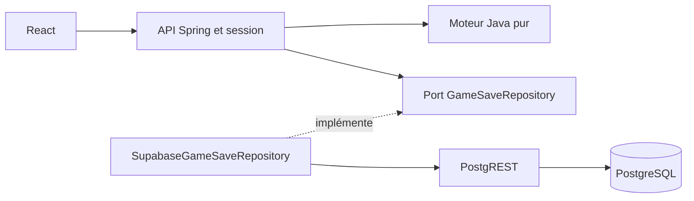

# Dames — fonctionnalité et preuves de qualité

État documentaire au **6 novembre 2026**, sur la base `dev` :
[`659d4fb937c3004f94e37265064b1b1a0caa952b`](https://github.com/EAnathos/tiki-gaming/commit/659d4fb937c3004f94e37265064b1b1a0caa952b).
Issue : [#18](https://github.com/EAnathos/tiki-gaming/issues/18).
Les extensions du 6 novembre sont conservées sur `game/dame/bilan-qualite`, sans nouvelle PR ; elles ne sont pas annoncées comme fusionnées dans `dev`.

## Parcourir le dossier

- [Nulles et reprise durable](nulles-et-reprise.md) : règles FMJD et sauvegarde du plateau.
- [Performance et résilience](performance-resilience.md) : k6 et pannes Toxiproxy réelles.
- [Bilan de qualité](qualite.md) : mesures datées, rapports CI et commandes de reproduction.
- [Matrice exigences/tests](rtm-matrix.md) : cas de référence et origine des résultats.
- [Cahier de recette](recette.md) : six parcours exécutés par l’agent, avec preuves ; validation humaine non prononcée.

## Fonctionnalité disponible

Deux participants jouent sur le même ordinateur, sans compte obligatoire.
Ils saisissent leurs noms, commencent une partie sur un damier 10 × 10
avec 20 pions par camp, puis jouent alternativement.

Le serveur applique les déplacements, prises obligatoires et majoritaires,
rafles, dames volantes, promotions en fin de coup et victoires par élimination
ou blocage, ainsi que les nulles automatiques FMJD. Un coup refusé conserve l'état de la partie.
Les noms, dates et résultat sont enregistrés dans PostgreSQL ; le gagnant est
calculé par le moteur Java, jamais fourni par le navigateur.

L'interface permet la sélection à la souris et au clavier, une revanche et
la reprise dans le même navigateur après fermeture ou redémarrage du serveur, si la base est conservée.
Elle réutilise le client HTTP de la plateforme, ses cookies et sa protection
CSRF. Un UUID connu ne suffit pas : un cookie privé au navigateur autorise la reprise.

## Architecture et frontières



Le moteur importe uniquement le JDK. Le service des rencontres dépend du port,
d'une horloge et d'un fournisseur d'UUID injectés. Les doublures de test se
placent à ces frontières ; les règles métier s'exécutent réellement.
Voir [architecture](architecture.md), [rencontres](rencontres.md),
[persistance](persistance.md) et [contrat API](api.md).

Le plateau, l'historique de nulle, la version et le résultat sont sauvegardés dans PostgreSQL à chaque coup. Une transaction compare la version attendue et conserve ensemble le plateau et le résultat. Le navigateur mémorise l'UUID dans `localStorage` et un cookie de reprise `HttpOnly` valable 30 jours ; seule son empreinte SHA-256 est stockée en base. Une nouvelle partie remplace le cookie et l'identifiant locaux. `MatchService` et `MatchRepository` restent le cas d'usage de métadonnées testé indépendamment.

## Lancer la démo sur une base jetable

Prérequis : Java 21, Maven, Docker démarré, dépendances frontend installées.
Depuis la racine du dépôt, laisser ouverts deux terminaux :

```bash
# Terminal 1 : vrai backend, PostgreSQL et PostgREST jetables
./tools/dame/demo-backend.sh
```

```bash
# Terminal 2 : interface React
./tools/dame/demo-frontend.sh
```

Ouvrir http://localhost:5173/games/dame. Le backend écoute par défaut sur 8080.
Les scripts utilisent des paramètres de démonstration et rejouent les migrations
sur une base vide ; ils ne configurent pas un déploiement de production.

Si le backend ne démarre pas, vérifier Docker et le port 8080 ; si Vite refuse
de démarrer, vérifier le port 5173. Lire l'erreur du terminal concerné.
Attention : ce script de démonstration détruit sa base au `Ctrl+C`. Le relancer crée donc une base vide ; la reprise durable nécessite de conserver PostgreSQL entre deux démarrages Java. Les tests d’intégration vérifient la reprise sur une base conservée.
Voir [les détails et limites de la démo](interface-e2e.md).

## Livraisons et contribution

| Livraison           | Contenu                                                                | Référence fusionnée                                                                   |
| ------------------- | ---------------------------------------------------------------------- | ------------------------------------------------------------------------------------- |
| Moteur              | Domaine Java, tests unitaires, analyse PIT                             | [PR #93](https://github.com/EAnathos/tiki-gaming/pull/93), 4 novembre 2026            |
| Parcours complet    | Rencontres, stockage, API, React, BDD, Pact, IT et parcours navigateur | [PR #116](https://github.com/EAnathos/tiki-gaming/pull/116), 5 novembre 2026          |
| Correction de revue | Attente de disponibilité PostgreSQL et nettoyage de dépendance         | [PR #131](https://github.com/EAnathos/tiki-gaming/pull/131), contribution du reviewer |

Les contributions Dames de Mamadou Cherif sont rattachées à l'identité Git
`DIALLO MAMADOU CHERIF <143650565+CherifDalein@users.noreply.github.com>`.
Les outils de CI, l'authentification et les composants de plateforme sont
collectifs. Le [journal TDD](journal-tdd.md) conserve les étapes de développement ;
il ne décrit pas à lui seul l'état actuel du jeu.

Exemples de traces conservées dans l'historique de `dev` :

- API : RED [`9946f9ff`](https://github.com/EAnathos/tiki-gaming/commit/9946f9ff)
  puis GREEN [`928bc39f`](https://github.com/EAnathos/tiki-gaming/commit/928bc39f).
- Interface : RED [`d7db710d`](https://github.com/EAnathos/tiki-gaming/commit/d7db710d)
  puis GREEN [`6d49fef0`](https://github.com/EAnathos/tiki-gaming/commit/6d49fef0).
- Contrat Pact [`b9386373`](https://github.com/EAnathos/tiki-gaming/commit/b9386373)
  et parcours navigateur [`f7eb1f26`](https://github.com/EAnathos/tiki-gaming/commit/f7eb1f26).

## Limites du lot et suites possibles

- Pas de multijoueur réseau, d'IA ni de classement de scores Dames.
- La reprise reste liée à ce navigateur, sans transfert entre appareils. Effacer le cookie supprime l’accès ; les anciennes parties créées avant cette extension n’ont pas de sauvegarde de plateau.
- Les rencontres abandonnées restent en cours ; aucune purge automatique n’est ajoutée.
- La comparaison de versions en base protège les écritures concurrentes ; aucun test complet de déploiement distribué n’est revendiqué.
- La suite Playwright de CI simule l'API. Pact et les IT apportent des preuves
  complémentaires. Une [campagne ponctuelle par l’agent](preuves/2026-11-06/README.md)
  a depuis exercé six parcours avec le vrai backend et la vraie base ; elle
  ne remplace pas une validation humaine ni une suite CI complète sur ces services.
- Les mesures k6 locales ciblent les Dames ; elles ne prouvent pas la capacité du déploiement de production.

Les documents historiques conservent leurs mesures et leurs étapes futures
telles qu'elles avaient été annoncées. Ce bilan indique ce qui a depuis été
livré. Les conventions de branche, de revue et de CI restent celles de
[CONTRIBUTING](../../CONTRIBUTING.md).
