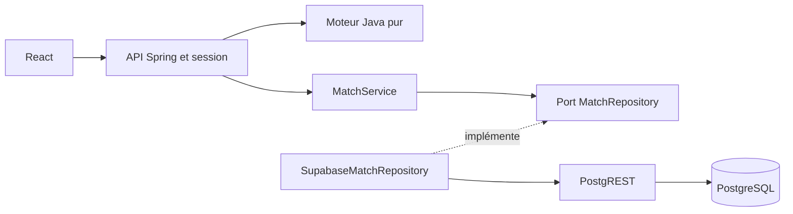

# Dames — bilan du lot livré

État documentaire au **6 novembre 2026**, sur la base `dev` :
[`659d4fb937c3004f94e37265064b1b1a0caa952b`](https://github.com/EAnathos/tiki-gaming/commit/659d4fb937c3004f94e37265064b1b1a0caa952b).
Issue : [#18](https://github.com/EAnathos/tiki-gaming/issues/18), ouverte.

## Fonctionnalité disponible

Deux participants jouent sur le même ordinateur, sans compte obligatoire.
Ils saisissent leurs noms, commencent une partie sur un damier 10 × 10
avec 20 pions par camp, puis jouent alternativement.

Le serveur applique les déplacements, prises obligatoires et majoritaires,
rafles, dames volantes, promotions en fin de coup et victoires par élimination
ou blocage. Un coup refusé conserve l'état de la partie.
Les noms, dates et résultat sont enregistrés dans PostgreSQL ; le gagnant est
calculé par le moteur Java, jamais fourni par le navigateur.

L'interface permet la sélection à la souris et au clavier, une revanche et
la reprise après rechargement tant que la session serveur reste valide.
Elle réutilise le client HTTP de la plateforme, ses cookies et sa protection
CSRF. Un UUID connu ne suffit pas à accéder à la rencontre d'une autre session.

## Architecture et frontières



Le moteur importe uniquement le JDK. Le service des rencontres dépend du port,
d'une horloge et d'un fournisseur d'UUID injectés. Les doublures de test se
placent à ces frontières ; les règles métier s'exécutent réellement.
Voir [architecture](architecture.md), [rencontres](rencontres.md),
[persistance](persistance.md) et [contrat API](api.md).

Le plateau est conservé dans la session serveur ; seul l'UUID est mémorisé
dans l'onglet. La base contient les métadonnées et le résultat, pas le plateau.
À la victoire, l'écriture du résultat précède la validation du nouvel état de
session. Les écritures conditionnelles et contraintes SQL empêchent de
remplacer un résultat terminé.

## Lancer la démo sur une base jetable

Prérequis : Java 21, Maven, Docker démarré, dépendances frontend installées.
Depuis la racine du dépôt, laisser ouverts deux terminaux :

```bash
# Terminal 1 : vrai backend, PostgreSQL et PostgREST jetables
./tools/dame/demo-backend.sh
```

```bash
# Terminal 2 : interface React
./tools/dame/demo-frontend.sh
```

Ouvrir http://localhost:5173/games/dame. Le backend écoute par défaut sur 8080.
Les scripts utilisent des paramètres de démonstration et rejouent les migrations
sur une base vide ; ils ne configurent pas un déploiement de production.

Si le backend ne démarre pas, vérifier Docker et le port 8080 ; si Vite refuse
de démarrer, vérifier le port 5173. Lire l'erreur du terminal concerné.
Après un redémarrage du backend, une ancienne session peut demander de créer
une nouvelle rencontre. Arrêter chaque processus avec `Ctrl+C` : les conteneurs
du backend sont fermés et leurs données détruites.
Voir [les détails et limites de la démo](interface-e2e.md).

## Livraisons et contribution

| Livraison | Contenu | Référence fusionnée |
|---|---|---|
| Moteur | Domaine Java, tests unitaires, analyse PIT | [PR #93](https://github.com/EAnathos/tiki-gaming/pull/93), 4 novembre 2026 |
| Parcours complet | Rencontres, stockage, API, React, BDD, Pact, IT et parcours navigateur | [PR #116](https://github.com/EAnathos/tiki-gaming/pull/116), 5 novembre 2026 |
| Correction de revue | Attente de disponibilité PostgreSQL et nettoyage de dépendance | [PR #131](https://github.com/EAnathos/tiki-gaming/pull/131), contribution du reviewer |

Les contributions Dames de Mamadou Cherif sont rattachées à l'identité Git
`DIALLO MAMADOU CHERIF <143650565+CherifDalein@users.noreply.github.com>`.
Les outils de CI, l'authentification et les composants de plateforme sont
collectifs. Le [journal TDD](journal-tdd.md) conserve les étapes de développement ;
il ne décrit pas à lui seul l'état actuel du jeu.

Exemples de traces conservées dans l'historique de `dev` :

- API : RED [`9946f9ff`](https://github.com/EAnathos/tiki-gaming/commit/9946f9ff)
  puis GREEN [`928bc39f`](https://github.com/EAnathos/tiki-gaming/commit/928bc39f).
- Interface : RED [`d7db710d`](https://github.com/EAnathos/tiki-gaming/commit/d7db710d)
  puis GREEN [`6d49fef0`](https://github.com/EAnathos/tiki-gaming/commit/6d49fef0).
- Contrat Pact [`b9386373`](https://github.com/EAnathos/tiki-gaming/commit/b9386373)
  et parcours navigateur [`f7eb1f26`](https://github.com/EAnathos/tiki-gaming/commit/f7eb1f26).

## Limites du lot et suites possibles

- Les règles de partie nulle restent à spécifier et à implémenter.
- Pas de multijoueur réseau, d'IA ni de classement de scores Dames.
- Pas de reprise durable du plateau après perte de session ou redémarrage ;
  une rencontre abandonnée reste enregistrée en cours.
- Une session possède une seule partie courante ; aucune garantie de
  coordination multi-nœuds n'est revendiquée.
- Les parcours Playwright simulent l'API. Pact et les IT apportent des preuves
  complémentaires ; ils ne constituent pas un E2E automatisé navigateur/base réel.
- Les mesures k6 collectives ne donnent pas une latence propre aux Dames.
  Une campagne de charge et des pannes réseau réelles Dames sont des suites possibles.

Les documents historiques conservent leurs mesures et leurs étapes futures
telles qu'elles avaient été annoncées. Ce bilan indique ce qui a depuis été
livré. Les conventions de branche, de revue et de CI restent celles de
[CONTRIBUTING](../../CONTRIBUTING.md).

