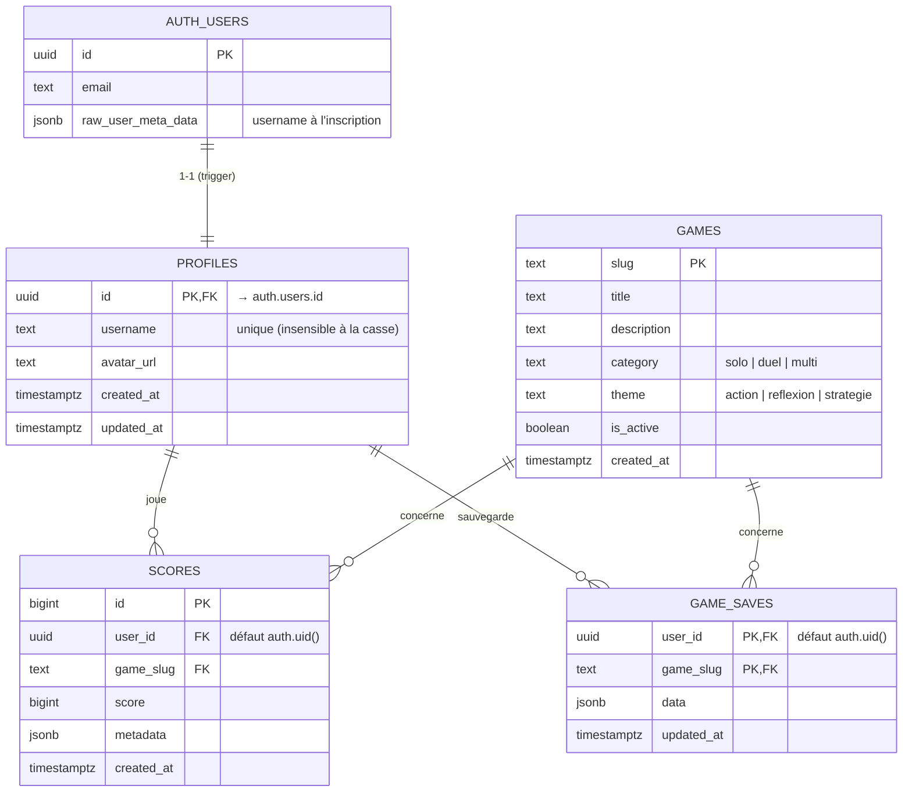

# Modèle de données

Base Postgres hébergée par Supabase. Le schéma est versionné dans `supabase/migrations/`. Les types
TypeScript correspondants sont dans `frontend/src/lib/database.types.ts` (`npm run db:types` après
chaque migration).



## Tables

### `profiles`

Profil public de chaque joueur, en relation 1-1 avec `auth.users`. Il est créé automatiquement à l'inscription.

| Colonne      | Type          | Contraintes                                                   |
|--------------|---------------|---------------------------------------------------------------|
| `id`         | `uuid`        | PK, FK `auth.users(id)` `on delete cascade`                   |
| `username`   | `text`        | `^[A-Za-z0-9_]{3,24}$`, unique sur `lower(username)`          |
| `avatar_url` | `text`        | nullable                                                      |
| `created_at` | `timestamptz` | défaut `now()`                                                |
| `updated_at` | `timestamptz` | maintenu par le trigger `profiles_set_updated_at`             |

Le motif du pseudo est dupliqué côté front dans `frontend/src/lib/validation.ts` : les deux doivent rester alignés.

### `games`

Catalogue des jeux : une ligne par jeu, ajoutée par une migration de l'équipe du jeu.

| Colonne       | Type          | Contraintes                                                       |
|---------------|---------------|-------------------------------------------------------------------|
| `slug`        | `text`        | PK, `^[a-z0-9]+(-[a-z0-9]+)*$`                                    |
| `title`       | `text`        | obligatoire                                                       |
| `description` | `text`        | nullable                                                          |
| `category`    | `text`        | **obligatoire, sans défaut**, `games_category_check` : `solo`, `duel`, `multi` |
| `theme`       | `text`        | **obligatoire, sans défaut**, `games_theme_check` : `action`, `reflexion`, `strategie` |
| `is_active`   | `boolean`     | défaut `true` ; un jeu inactif n'accepte plus de nouveaux scores  |
| `max_score`   | `bigint`      | nullable, `>= 0` ; score maximal accepté (null = pas de limite)   |
| `created_at`  | `timestamptz` | défaut `now()`                                                    |

`category` et `theme` doivent correspondre aux champs du même nom de la `GameDefinition` du jeu
(`frontend/src/games/categories.ts`, `frontend/src/games/themes.ts`) ; `tests/integration/catalog.test.ts` le vérifie.

### `scores`

Historique des parties, lisible par tous. **Seul le backend Java écrit** (`POST /api/scores`, clé
`service_role`) : un joueur ne peut pas insérer de score depuis le navigateur, même le sien.

Le trigger `scores_check_allowed` vérifie chaque insertion, quel que soit son auteur (la RLS ne s'applique pas
au `service_role`) : jeu actif (sinon `55000`) et score au plus `games.max_score` (sinon `23514`). Un score
négatif est refusé par `scores_score_check` (`23514`), un jeu inconnu par la clé étrangère (`23503`).

| Colonne      | Type          | Contraintes                                                    |
|--------------|---------------|----------------------------------------------------------------|
| `id`         | `bigint`      | PK, identité                                                   |
| `user_id`    | `uuid`        | FK `profiles(id)` `on delete cascade`, fourni par le backend    |
| `game_slug`  | `text`        | FK `games(slug)` `on delete cascade`                           |
| `score`      | `bigint`      | obligatoire, `>= 0`, **plus haut = meilleur**                  |
| `metadata`   | `jsonb`       | défaut `{}` (durée, niveau… libre par jeu)                      |
| `created_at` | `timestamptz` | défaut `now()`                                                 |

Index : `(game_slug, score desc)` pour les classements, `(user_id)`.

### `game_saves`

Une sauvegarde JSON par joueur et par jeu.

| Colonne      | Type          | Contraintes                                                    |
|--------------|---------------|----------------------------------------------------------------|
| `user_id`    | `uuid`        | PK, FK `profiles(id)` `on delete cascade`, défaut `auth.uid()`  |
| `game_slug`  | `text`        | PK, FK `games(slug)` `on delete cascade`                       |
| `data`       | `jsonb`       | défaut `{}`                                                    |
| `updated_at` | `timestamptz` | maintenu par le trigger `game_saves_set_updated_at`            |

### Vue `leaderboard`

Meilleur score par joueur et par jeu (`best_score`, `games_played`, `last_played_at`, avec `username`
et `avatar_url`). Elle est déclarée `security_invoker` et respecte donc la RLS de l'appelant.

## Droits et RLS

Toutes les tables ont la **RLS activée** et des privilèges explicites (pas de grants par défaut).

| Table / vue   | `anon` (invité) | `authenticated` (connecté)                                    |
|---------------|-----------------|---------------------------------------------------------------|
| `profiles`    | lecture         | lecture ; mise à jour de `username`, `avatar_url` de **son** profil |
| `games`       | lecture         | lecture (écriture uniquement par migration)                   |
| `scores`      | lecture         | lecture (insertion par le backend uniquement)                 |
| `game_saves`  | —               | lecture / écriture / suppression de **ses** sauvegardes       |
| `leaderboard` | lecture         | lecture                                                       |

Pour une requête du front, « connecté » signifie que la requête porte le JWT émis par le backend Java
(voir [architecture.md](architecture.md#authentification)).

## Fonctions et triggers

| Objet                          | Rôle                                                                              |
|--------------------------------|-----------------------------------------------------------------------------------|
| `handle_new_user()` + trigger `on_auth_user_created` | Crée le profil à l'insertion dans `auth.users`. Le pseudo vient de `raw_user_meta_data.username` ; il est nettoyé et dédoublonné, avec repli sur `joueur_<id>` |
| `set_updated_at()`             | Maintient `updated_at` (`profiles`, `game_saves`)                                  |
| `find_auth_user_id(email)`     | `security definer`, exécutable **uniquement par `service_role`** : le backend retrouve le compte d'un email vérifié par Google |

## Migrations

| Fichier                                   | Contenu                                         |
|-------------------------------------------|-------------------------------------------------|
| `20261102000000_init_platform.sql`        | Schéma socle, RLS, jeu d'exemple `clicker`       |
| `20261102120000_auth_user_lookup.sql`     | Fonction `find_auth_user_id`                     |
| `20261102130000_game_categories.sql`      | Colonne `games.category` + contrainte            |
| `20261103160000_game_themes.sql`          | Colonne `games.theme` + contrainte               |

Les règles (une migration par changement, jamais modifiée une fois fusionnée, application en
production par l'équipe plateforme) sont dans [CONTRIBUTING.md](../CONTRIBUTING.md#migrations-de-base-de-données).

Exemple d'ajout d'un jeu au catalogue :

```sql
insert into public.games (slug, title, description, category, theme)
values ('mastermind', 'Mastermind', 'Trouve la combinaison secrète en un minimum de coups.', 'solo', 'reflexion');
```
