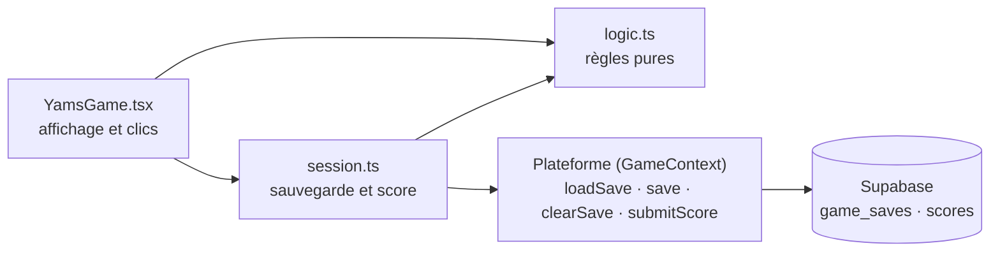
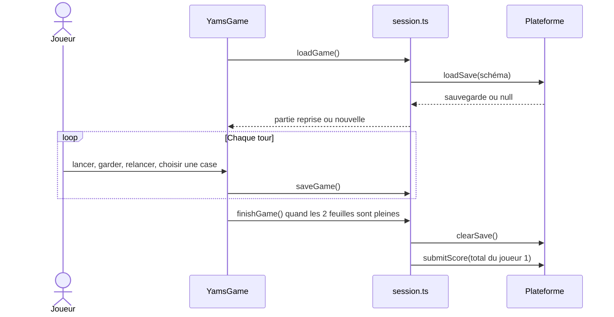
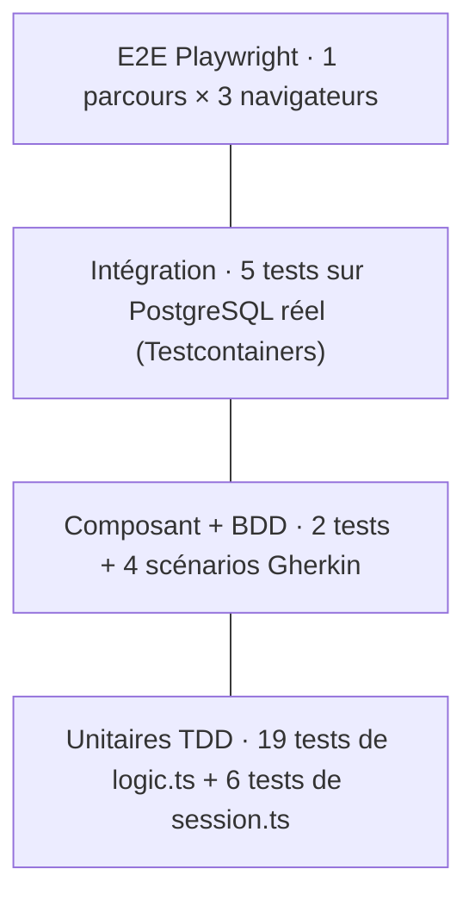

# Yams

Jeu de dés à **2 joueurs sur le même écran** (hot-seat) intégré à la plateforme Tiki Gaming.
Chaque joueur lance 5 dés jusqu'à 3 fois par tour, garde ceux qu'il veut, puis inscrit le résultat dans une des 13 cases de sa feuille de score. Quand les deux feuilles sont pleines, le plus gros total gagne.

- Route : `/games/yams`
- Catégorie : `solo` (un seul appareil) · thème : `strategie`
- Score maximal accepté par la plateforme : **375**
- Le **joueur 1** est le compte connecté : seul son total est envoyé au classement. Le joueur 2 joue sans compte.

---

## Sommaire

1. [Règles du jeu](#1-règles-du-jeu)
2. [Organisation du code](#2-organisation-du-code)
3. [Déroulement d'une partie](#3-déroulement-dune-partie)
4. [Stratégie de test](#4-stratégie-de-test)
5. [Inventaire des tests](#5-inventaire-des-tests)
6. [Valeurs limites (BVA)](#6-valeurs-limites-bva)
7. [Qualité mesurée](#7-qualité-mesurée)
8. [Traçabilité et anomalies](#8-traçabilité-et-anomalies)
9. [Lancer les tests](#9-lancer-les-tests)
10. [Limites connues et suite](#10-limites-connues-et-suite)

---

## 1. Règles du jeu

### Le tour

| Étape            | Règle                                                                                        |
| ---------------- | -------------------------------------------------------------------------------------------- |
| 1er lancer       | Les 5 dés sont lancés, aucun n'est gardé.                                                    |
| Garder           | Le joueur clique sur un dé pour le garder ou le relâcher.                                    |
| Relances         | Jusqu'à 2 relances (3 lancers au total). Seuls les dés **non gardés** sont relancés.         |
| Choisir une case | Le joueur inscrit ses dés dans une case libre de sa feuille. La main passe à l'autre joueur. |

Une case remplie ne peut plus être rejouée. Une case peut être **barrée** : elle vaut alors 0 mais compte comme jouée.

### La feuille de score

| Section | Case         | Condition                   | Points                   |
| ------- | ------------ | --------------------------- | ------------------------ |
| Haute   | As … Six     | —                           | Somme des dés de la face |
| Haute   | **Bonus**    | Section haute ≥ **63**      | **+35**                  |
| Basse   | Brelan       | 3 dés identiques            | Somme des 5 dés          |
| Basse   | Carré        | 4 dés identiques            | Somme des 5 dés          |
| Basse   | Full         | 3 identiques + 2 identiques | 25                       |
| Basse   | Petite suite | 4 valeurs qui se suivent    | 30                       |
| Basse   | Grande suite | 5 valeurs qui se suivent    | 40                       |
| Basse   | Yams         | 5 dés identiques            | 50                       |
| Basse   | Chance       | —                           | Somme des 5 dés          |

Règles validées avec l'équipe :

- un Yams (5 dés identiques) **n'est pas** un full : 4-4-4-4-4 vaut 0 dans la case Full ;
- **pas de prime** pour un deuxième Yams ;
- le total maximal théorique est **375** (le plafond enregistré dans la table `games`).

---

## 2. Organisation du code

```
frontend/src/games/yams/
├── index.ts                         déclaration du jeu (slug, catégorie, plafond 375)
├── logic.ts                         règles pures : scores, feuille, tour, partie à 2
├── session.ts                       lien avec la plateforme : sauvegarde, reprise, fin de partie
├── YamsGame.tsx                     écran React (aucune règle, tout vient de logic.ts)
├── yams.css                         styles du jeu
├── logic.test.ts                    tests unitaires TDD des règles
├── session.test.ts                  tests de la sauvegarde et de l'envoi du score
├── YamsGame.test.tsx                tests du composant
└── features/
    ├── feuille-de-score.feature     scénarios BDD en français (Gherkin)
    └── feuille-de-score.steps.test.ts

frontend/tests/integration/yams.test.ts   intégration avec une vraie base PostgreSQL
frontend/e2e/yams.spec.ts                 parcours de bout en bout (Playwright)
docs/games/yams/rtm-matrix.md             matrice de traçabilité et anomalies
quality/k6/yams.js                        test de charge de la fin de partie
```

### Séparation des responsabilités



- **`logic.ts`** ne dépend ni de React ni de la plateforme. Le lancer de dé (`RollDie`) est **injecté** : en test, on fournit des dés fixes, donc les tests sont déterministes.
- **`session.ts`** valide la sauvegarde avec un schéma `zod`. Une sauvegarde abîmée ou d'un ancien format est ignorée et une nouvelle partie commence.
- **`YamsGame.tsx`** ne contient aucune règle : il appelle les fonctions de `logic.ts` et `session.ts`.

### Principales fonctions de `logic.ts`

| Fonction                                      | Rôle                                                                 |
| --------------------------------------------- | -------------------------------------------------------------------- |
| `scoreCategory(dice, category)`               | Points que vaudraient les dés dans une case                          |
| `fillCategory(sheet, category, dice)`         | Renvoie une nouvelle feuille ; lève si la case est déjà jouée        |
| `upperSubtotal` / `upperBonus` / `totalScore` | Sous-total haut, bonus de 35, total                                  |
| `startTurn` / `toggleKeep` / `reroll`         | Tour de jeu ; lève pour un dé inexistant ou un 4ᵉ lancer             |
| `newGame` / `roll` / `playCategory`           | Partie à deux joueurs, passage de la main                            |
| `isGameOver` / `winner`                       | Fin de partie quand les 2 feuilles sont pleines ; gagnant ou égalité |

---

## 3. Déroulement d'une partie



`finishGame` ne fait **rien** tant que la partie n'est pas terminée et n'envoie le score **qu'une seule fois**. En invité, aucun score n'est enregistré.

Côté base, la fin de partie est **atomique** : si le score est refusé (au-dessus de 375), la sauvegarde effacée revient. Depuis la migration `scores_server_only`, seul le serveur (`service_role`) peut écrire dans `scores`.

---

## 4. Stratégie de test

### La pyramide



Beaucoup de tests rapides en bas (les règles), peu de tests lents en haut (le parcours complet).

### TDD : le test avant le code

Les règles de `logic.ts` ont été écrites en cycles **Rouge → Vert → Nettoyer** :

1. **Rouge** : écrire un test qui échoue (ex. « donne 25 points pour un full, rien pour deux paires ») ;
2. **Vert** : écrire le code minimal qui le fait passer ;
3. **Nettoyer** : refactorer sans casser les tests.

Les commits rouge puis vert sont visibles dans l'historique Git (ex. l'envoi du score en fin de partie).

### BDD : les Trois Amigos

Après les premiers tests TDD, un atelier **Trois Amigos** (métier, développement, test) a fixé les règles discutables (le Yams est-il un full ? y a-t-il une prime ?). Les exemples retenus sont écrits en Gherkin français dans [`feuille-de-score.feature`](features/feuille-de-score.feature) et exécutés par `vitest-cucumber` :

| Scénario                                             | Ce qu'il fixe                                              |
| ---------------------------------------------------- | ---------------------------------------------------------- |
| Un full inscrit dans sa case rapporte 25 points      | Le cas nominal                                             |
| Une case déjà jouée ne peut pas être rejouée         | Le cas d'erreur                                            |
| Plan : les combinaisons à la frontière des règles    | Full, carré, petite suite et Yams à la limite (8 exemples) |
| Plan : le bonus de 35 points se gagne à partir de 63 | La valeur limite du bonus                                  |

### Doublures de test

| Doublure                                                         | Où                                               | Pourquoi                                             |
| ---------------------------------------------------------------- | ------------------------------------------------ | ---------------------------------------------------- |
| **Stub** : un faux dé (`RollDie` qui renvoie des valeurs fixes)  | `logic.test.ts`, E2E (`Math.random = () => 0.5`) | Rendre le hasard prévisible                          |
| **Fake** : une fausse base en mémoire (`FakeScores`, `fakeDeps`) | `session.test.ts`                                | Tester la sauvegarde et l'envoi du score sans réseau |
| **Spy** : `vi.spyOn(ctx, 'submitScore')`                         | `session.test.ts`                                | Vérifier que le score n'est envoyé qu'une fois       |

---

## 5. Inventaire des tests

### Unitaires : `logic.test.ts` (19 tests)

| Bloc             | Tests                                                                                                                                                                    |
| ---------------- | ------------------------------------------------------------------------------------------------------------------------------------------------------------------------ |
| `scoreCategory`  | section haute · brelan (pas avec une paire) · carré · full (pas deux paires) · petite suite (avec doublon, pas trouée) · grande suite · Yams (pas 4 identiques) · chance |
| Feuille de score | bonus de 35 à partir de 63 · case inscrite puis indisponible · case déjà jouée refusée · pas de prime pour un 2ᵉ Yams                                                    |
| Tour de jeu      | ne relance que les dés non gardés · refuse un dé inexistant et un 4ᵉ lancer                                                                                              |
| Partie à deux    | 5 dés puis relance · la main passe à l'autre · refuse une case avant d'avoir lancé · finie quand les 2 feuilles sont pleines · gagnant ou égalité                        |

### Session : `session.test.ts` (6 tests)

| Bloc         | Tests                                                                                                                            |
| ------------ | -------------------------------------------------------------------------------------------------------------------------------- |
| `finishGame` | envoie une seule fois le total du joueur 1 · n'envoie rien tant que le joueur 2 n'a pas fini · aucun score en invité             |
| Sauvegarde   | reprend une partie au même point · nouvelle partie sans sauvegarde ou si elle est abîmée · efface la sauvegarde en fin de partie |

### Composant : `YamsGame.test.tsx` (2 tests)

- le joueur 1 lance, garde un dé, relance puis choisit une case : la main passe au joueur 2 ;
- annonce le gagnant et rappelle à l'invité qu'il n'est pas classé.

### BDD : `features/` (4 scénarios)

Voir le tableau de la [section 4](#bdd--les-trois-amigos).

### Intégration : `tests/integration/yams.test.ts` (5 tests)

| Bloc                          | Test                                                                                                                        |
| ----------------------------- | --------------------------------------------------------------------------------------------------------------------------- |
| Migrations rejouées           | la migration `add_game_yams` est appliquée, plafond 375 au catalogue                                                        |
| Unicité                       | un second jeu « yams » est refusé (`23505`) · une seule sauvegarde par joueur (`23505`)                                     |
| Atomicité de la fin de partie | **376** refusé (`23514`) : rien n'est écrit, la sauvegarde revient · **375** accepté : sauvegarde effacée, score enregistré |

### E2E : `e2e/yams.spec.ts` (1 parcours)

Le joueur 1 lance, garde un dé, relance, choisit une case : la main passe au joueur 2. Exécuté sur **Chromium, Firefox et WebKit**.

### Charge : `quality/k6/yams.js`

50 joueurs virtuels pendant 1 minute rejouent la fin de partie (effacer la sauvegarde, puis enregistrer le score).

---

## 6. Valeurs limites (BVA)

Deux frontières du Yams sont testées **des deux côtés** :

| Frontière                 | Juste en dessous  | Pile sur la limite  | Tests                                  |
| ------------------------- | ----------------- | ------------------- | -------------------------------------- |
| Bonus de la section haute | 62 → pas de bonus | 63 → +35 (64 aussi) | `logic.test.ts`, scénario BDD du bonus |
| Plafond du score          | —                 | 375 accepté         | intégration                            |
| Au-dessus du plafond      | 376 refusé        | —                   | intégration                            |

Les combinaisons ont aussi leurs frontières : paire ≠ brelan, 3 identiques ≠ carré, deux paires ≠ full, Yams ≠ full, 4 identiques ≠ Yams, série trouée ≠ petite suite.

---

## 7. Qualité mesurée

| Mesure                                     | Résultat                                                                                         |
| ------------------------------------------ | ------------------------------------------------------------------------------------------------ |
| Tests unitaires et de composant            | tous verts                                                                                       |
| Couverture (SonarQube, nouveau code)       | **95,9 %** · Quality Gate **PASSED**                                                             |
| Score de mutation (Stryker sur `logic.ts`) | **95,83 %** : 192 mutants, 184 tués, 4 équivalents, 4 survivants                                 |
| CI de la PR #41                            | 15 jobs sur 15 verts                                                                             |
| Charge k6 (50 VUs, 1 min)                  | 5 930 requêtes · **0 %** d'erreur · P95 **12,5 ms** (seuil 300 ms) · P99 105,2 ms (seuil 500 ms) |

**Couverture ≠ mutation** : la couverture dit qu'une ligne a été exécutée, la mutation dit si un test **échoue** quand on modifie le code. Les 4 mutants survivants sont listés dans la [section 10](#10-limites-connues-et-suite).

---

## 8. Traçabilité et anomalies

La matrice [`docs/games/yams/rtm-matrix.md`](../../../../docs/games/yams/rtm-matrix.md) relie :

**6 exigences** (REQ-YAMS-01 à 06) → **12 cas de test** (TC-YAMS-01 à 12) → la preuve (fichier et titre exact du test) → les anomalies.

| Anomalie    | Résumé                                                                                                                              | Sévérité · priorité | État           |
| ----------- | ----------------------------------------------------------------------------------------------------------------------------------- | ------------------- | -------------- |
| BUG-YAMS-01 | Étapes BDD exécutées dans le désordre (une étape « Alors » avant son « Quand »), trouvé par le test anti-flaky `--sequence.shuffle` | S2 · P1             | Clos (PR #124) |
| BUG-YAMS-02 | Écriture du score refusée (`42501`) après la migration `scores_server_only` ; faux positif sur le test du 376                       | S2 · P1             | Clos (PR #124) |

Le test du 376 passait pour une **mauvaise raison** (refus de droit `42501` au lieu du plafond `23514`). Il vérifie maintenant le bon code d'erreur et écrit avec le rôle serveur, comme le backend.

---

## 9. Lancer les tests

Depuis `frontend/` :

```bash
# Unitaires, session, composant et BDD du Yams
npx vitest run src/games/yams

# Intégration sur PostgreSQL (Docker requis)
npm run test:integration -- yams

# E2E sur les 3 navigateurs
npm run test:e2e -- yams

# Mutation sur les règles
npx stryker run --mutate src/games/yams/logic.ts

# Couverture
npm run test:coverage -- src/games/yams
```

Test de charge, depuis la racine du dépôt (environnement local uniquement) :

```bash
docker compose -f quality/docker-compose.yml up -d db rest
npm --prefix frontend run quality:seed
docker compose -f quality/docker-compose.yml run --rm k6 run --quiet /quality/k6/yams.js
```

Le résumé est aussi écrit dans `quality/reports/k6-yams.json`.